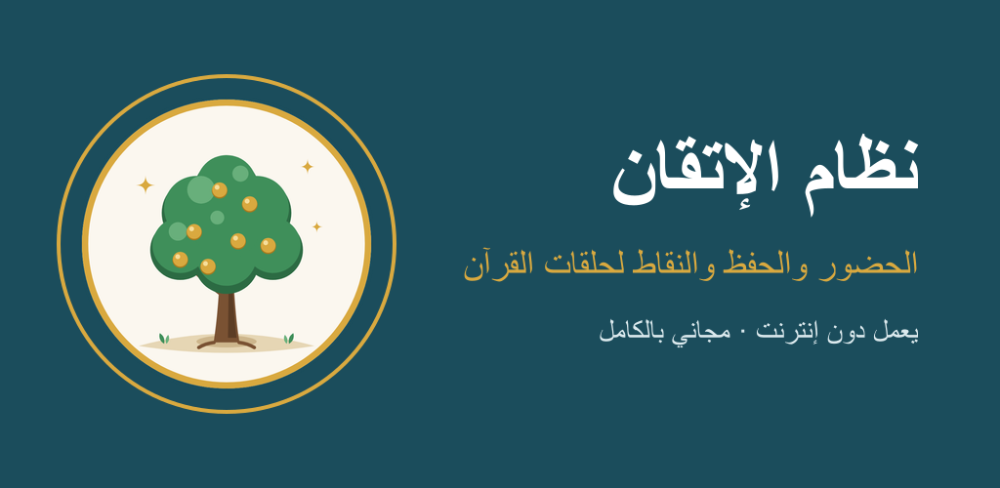
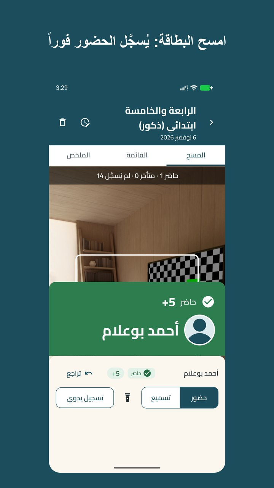
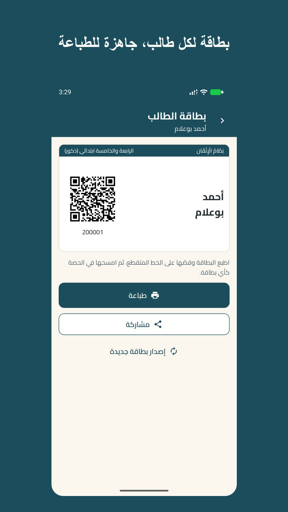
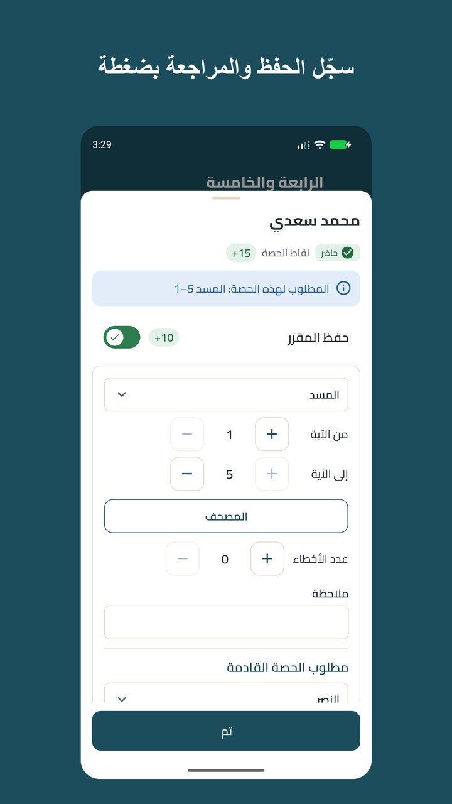
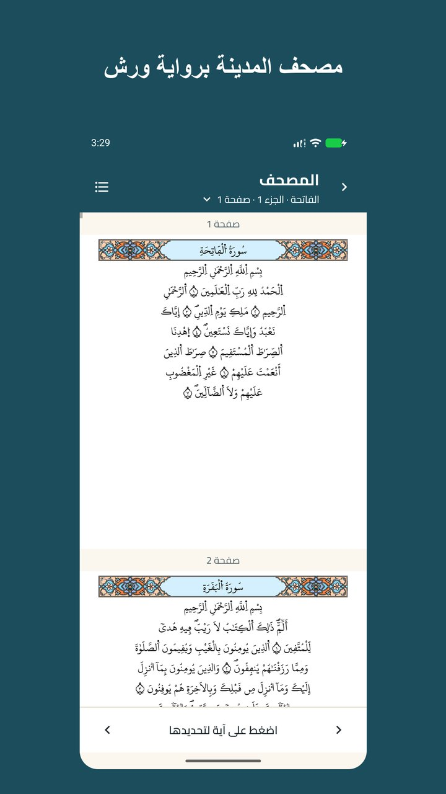
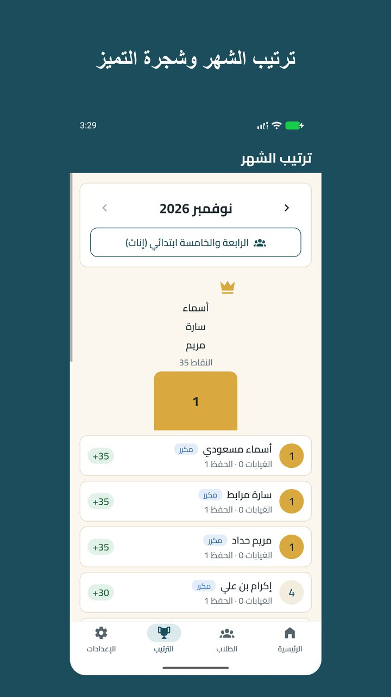
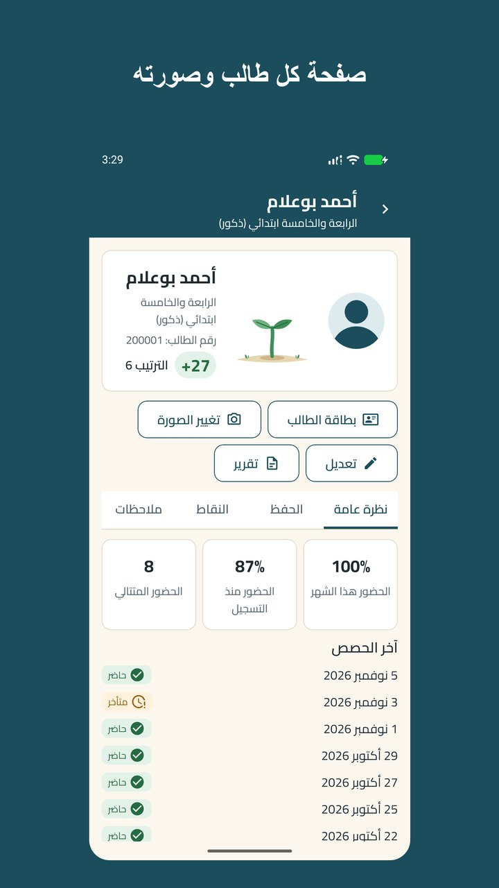
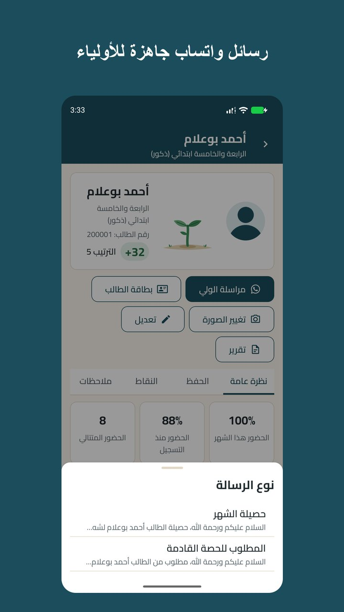
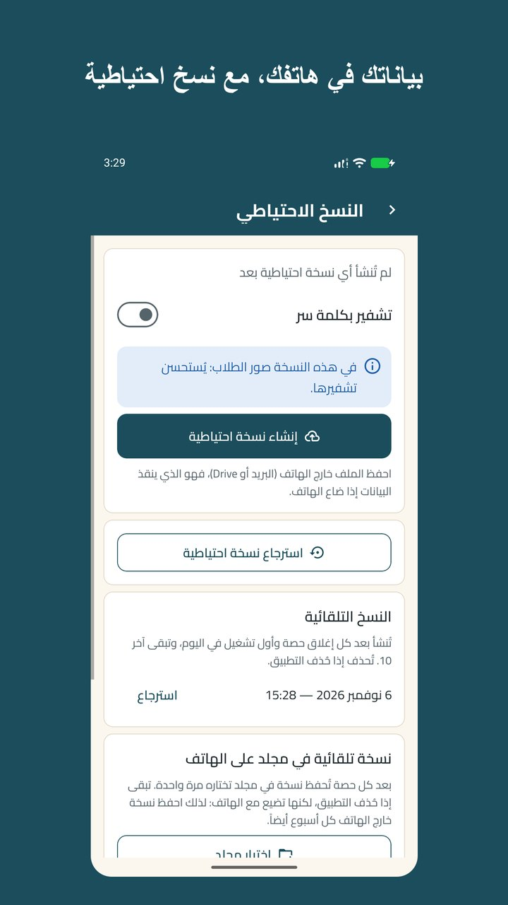

# نظام الإتقان

**تطبيق مجاني لمعلّمي حلقات القرآن الكريم** 
الحضور ببطاقات QR · تسجيل الحفظ · النقاط والترتيب الشهري · دون إنترنت

 

## ما هو «نظام الإتقان»؟

تطبيق أندرويد يساعد معلّم الحلقة في كل حصة: يسجّل حضور الطلاب بمسح بطاقاتهم، ويحفظ ما سمّعه كل طالب، ويحسب النقاط ويرتّب الطلاب كل شهر. كل شيء داخل هاتفك: لا حساب، ولا إنترنت، ولا إعلانات.

## المزايا

| | |
|---|---|
| 🪪 **بطاقة لكل طالب** | يصنع التطبيق بطاقة برمز QR لكل طالب تضيفه، فتطبعها وتسلّمها له. |
| 📷 **حضور في لحظة** | وجّه الكاميرا إلى البطاقة: يُسجَّل الطالب حاضراً أو متأخراً وتُضاف نقاطه. |
| 📖 **الحفظ والمراجعة** | سجّل الحفظ والمراجعة والتثبيت والمتون بضغطة، ويُقترح المقطع التالي لكل طالب. |
| 🕌 **مصحف المدينة برواية ورش** | من مجمع الملك فهد لطباعة المصحف الشريف، كما أصدره المجمع، لتتابع الطالب آية بآية. |
| 🏆 **النقاط والترتيب** | ترتيب شهري للحلقة، وشجرة تميّز لكل طالب، وشهادة للمتصدر، وتقارير وملف Excel. |
| 🖼️ **صور الطلاب** | صورة لكل طالب تظهر عند مسح بطاقته وفي القوائم، ولا تظهر في التقارير. |
| 💬 **أولياء الأمور** | رسائل واتساب جاهزة: الغياب، حصيلة الشهر، المطلوب للحصة القادمة. |
| 🔒 **بياناتك في هاتفك** | نسخ احتياطية تحفظها حيث تشاء، مشفّرة بكلمة سر إن أردت، وقفل بالبصمة. |

وفي التطبيق جولة متحركة تشرح كل خطوة، وصفحة أسئلة وأجوبة.

## صور من التطبيق

<table>
<tr>
<td></td>
<td></td>
<td></td>
<td></td>
</tr>
<tr>
<td></td>
<td></td>
<td></td>
<td></td>
</tr>
</table>

الأسماء في الصور مخترعة، والصور الشخصية رسوم توضيحية.

## التثبيت

1. افتح هذه الصفحة من هاتفك، واضغط زر **Download APK** أعلاه (حوالي 82 ميغابايت).
2. افتح الملف بعد تحميله. إذا سأل الهاتف عن «تثبيت تطبيقات غير معروفة» فاسمح بذلك للمتصفح أو لتطبيق الملفات.
3. قد يحذّر Play Protect من مطوّر غير معروف لأن التطبيق ليس من المتجر: اختر «تثبيت على أي حال».
4. افتح التطبيق وأكمل خطوات الإعداد الأربع: اسمك، والمدرسة، وحلقتك الأولى، وقواعد النقاط.

**يحتاج إلى:** أندرويد 8.0 أو أحدث، وكاميرا.

**التحديث:** حمّل الإصدار الجديد من صفحة [الإصدارات](https://github.com/Mohamed-Guilane/nizam-al-itqan/releases) وثبّته فوق القديم: تبقى بياناتك كما هي. وأنشئ نسخة احتياطية قبل كل تحديث.

**التحقق من الملف:** بصمة SHA-256 لكل ملف مكتوبة في صفحة إصداره.

## الخصوصية

لا يملك التطبيق إذن الوصول إلى الإنترنت: أسماء الطلاب وصورهم وحضورهم ونقاطهم تبقى داخل هاتفك، ولا يراها المطوّر ولا أحد غيرك. لا تخرج البيانات إلا عندما تشارك بنفسك نسخة احتياطية أو تقريراً أو رسالة. التفاصيل في [سياسة الخصوصية](PRIVACY.md).

## الترخيص

جميع الحقوق محفوظة لمطوّره M.G. © 2026. يجوز لك مشاركة هذا التطبيق مع المعلمين الآخرين مجاناً لتعمّ المنفعة، كما هو دون تعديل. ويُمنع بيعه أو تعديله أو نسبته إلى غير مطوّره. التفاصيل في [LICENSE.md](LICENSE.md).

هذا المستودع لنشر التطبيق فقط، ولا يحتوي على شيفرته المصدرية.

## شكر وتقدير

- **المصحف وعدّ الآيات:** مصحف المدينة النبوية برواية ورش عن نافع، الإصدار 2.1، من [مجمع الملك فهد لطباعة المصحف الشريف](https://qurancomplex.gov.sa)، يُعرض كما أصدره المجمع دون أي تعديل.
- **الخط:** Cairo، برخصة SIL Open Font License 1.1.
- **أسماء السور:** [Tanzil.net](https://tanzil.net)، برخصة CC BY 3.0.

## تواصل

لسؤال أو اقتراح: من داخل التطبيق **الإعدادات ← حول التطبيق ← تواصل مع المطوّر**.

